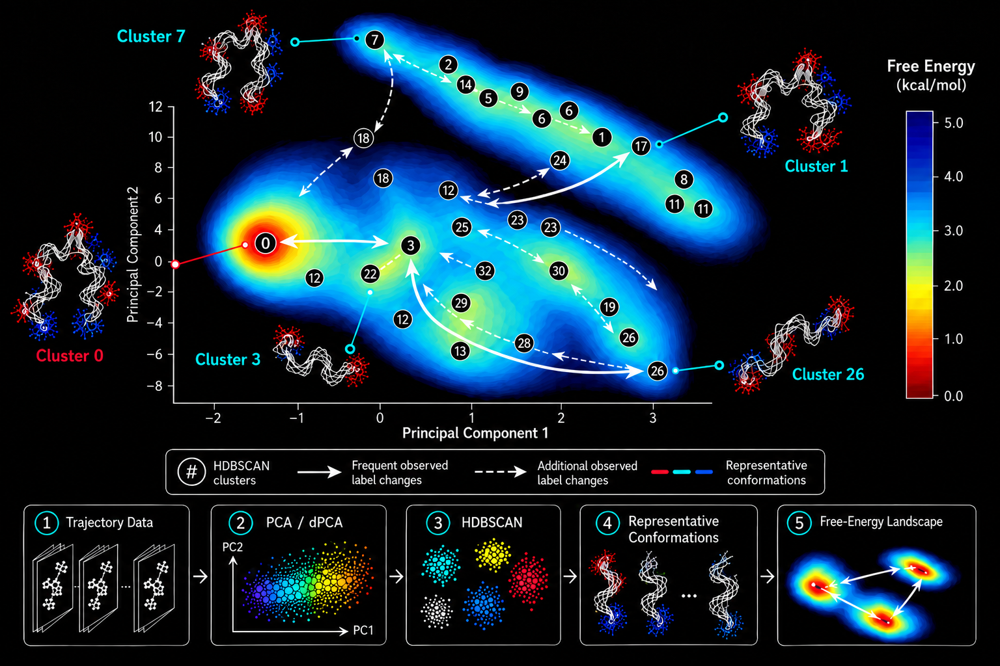

# clusterMD

**Automated multidimensional clustering and structural characterization of molecular-dynamics trajectories using PCA/dPCA and HDBSCAN.**

`clusterMD` is a command-line research workflow that connects molecular-dynamics (MD) trajectories to density-defined groups of sampled molecular conformations. It clusters **multidimensional** principal-component analysis (PCA) or dihedral PCA (dPCA) coordinates, relates the assignments to the original trajectory frames, and produces structural representatives, cluster-associated structural ensembles, population summaries, descriptive free-energy visualizations, and observed label-change analyses.

It supports **carma** and **GROMACS** workflows, using either existing projection files or generating PCA/dPCA projections from supported trajectory inputs.

<p align="center">
  
</p>

<p align="center"><em>Graphical overview of clusterMD. Clustering takes place in the selected multidimensional projection space; two-dimensional landscapes are visualizations. Observed changes between assigned labels do not, on their own, establish kinetic transitions.</em></p>

---

## Overview

Molecular-dynamics (MD) simulations describe molecular motion as a sequence of atomistic configurations. Understanding the conformational organization sampled by a trajectory, however, requires more than inspecting individual structures: it requires identifying recurrent regions of conformational space, relating them to physically observed configurations, and examining how the trajectory moves among them.

`clusterMD` provides an integrated computational approach to this problem. It represents sampled conformations using principal-component analysis (**PCA**) or dihedral principal-component analysis (**dPCA**) coordinates and applies **HDBSCAN** to identify density-defined groups in the **retained multidimensional projection space**. Unlike approaches that cluster only the first two components displayed in a figure, clusterMD uses the number of dimensions specified for the analysis. Configurations that are not assigned to a selected cluster remain explicitly **unassigned** rather than being forced into a group.

The connection to the original MD trajectory is preserved throughout the analysis. Each assigned observation can be traced to its source frame, enabling cluster-associated structures to be extracted and compared. For every cluster, clusterMD selects an *observed* conformation nearest the arithmetic centroid in projection space, supports structural fitting and optional RMSD-based retention, and summarizes the resulting structural ensemble. In parallel, it reports cluster populations, constructs descriptive free-energy visualizations, and examines changes between assigned labels in trajectory order.

The software supports both **carma** and **GROMACS** workflows: researchers can analyze existing PCA/dPCA projections or generate them from compatible trajectory and topology inputs. The clustering and subsequent structural analyses can also be used separately through `--cluster-only`, allowing rapid exploration before performing more extensive characterization.

### Scientific scope

The results are intended to support **exploratory and reproducible conformational analysis**. HDBSCAN clusters describe density structure in a chosen representation; they do not automatically establish metastable or thermodynamic states. Likewise, observed label changes summarize the temporal ordering of assignments but are not kinetic rate estimates. Population-based free-energy descriptions depend on the sampling and assumptions of the underlying simulation. The scientific interpretation and limitations of these outputs are discussed below.

## Key features

- Multidimensional HDBSCAN clustering with `eom` or `leaf` cluster selection.
- Existing-projection ingestion and native PCA/dPCA generation paths for carma and GROMACS.
- Manual clustering parameters or the optional `--auto` heuristic.
- Original frame identity and backend-aware mapping to trajectories.
- Population accounting including **Unassigned** observations (machine-readable label `-1`).
- Cluster populations, descriptive free-energy surfaces, two-dimensional projection figures and cluster connectivity views.
- Representative structures selected from **actual sampled frames**, not artificial centroid structures.
- Cluster-associated trajectories, structural alignment and optional RMSD-based filtering.
- Post-run examination of observed label changes and their chronology.
- A fast `--cluster-only` mode for preliminary clustering and parameter exploration.
- Human-readable analysis reports, execution logs, projection diagnostics when applicable and machine-readable provenance.

## Installation

### Requirements

- **Python 3.12** is the version used for the fresh-install release checks. The package currently declares Python **3.10 or newer**, but not every Python/platform combination has been independently validated.
- A standard Python virtual environment and `pip`.
- **carma** installed separately when using carma-based projection generation or structural processing.
- **GROMACS** and its relevant executable(s) installed separately where required by GROMACS-native operations. The Python package does not install carma or GROMACS.
- The associated trajectory and topology/run-input files appropriate to the selected backend.

### Install as a Python package

Clone the repository and create an isolated environment:

```bash
git clone https://github.com/tasosmelas/clusterMD.git
cd clusterMD
python3.12 -m venv .venv
```

Activate it in **Bash/Zsh**:

```bash
source .venv/bin/activate
```

Or in **Fish**:

```fish
source .venv/bin/activate.fish
```

Then install clusterMD from the repository root:

```bash
python -m pip install .
python -m pip check
clusterMD --help
```

The package installs the `clusterMD` command into the active virtual environment. Activate the environment in future shell sessions before running an analysis.

### Dependency compatibility

An ordinary `pip install .` resolves compatible dependencies at installation time. Tested Python 3.12 workflows completed with **NumPy 2.5.4**, **SciPy 1.18.1**, **fast-hdbscan 0.3.2**, **Numba 0.68.0** and **scikit-learn 1.9.1**. This confirms compatibility for the workflows exercised, not for every Python environment or scientific use case.

## Input data and frame identity

### Supported workflow inputs

| Backend | Projection | Trajectory | Topology / run input |
| --- | --- | --- | --- |
| carma | Existing PCA/dPCA `*.dat` or newly generated projection | DCD | PSF |
| GROMACS | Existing compatible XVG or newly generated projection | XTC / TRR | TPR / GRO |

Provide files explicitly with `--file`, `--traj` and `--topo` when possible. clusterMD can search for compatible files automatically, but you should **read its resolved-input summary** and confirm that the selected trajectory, topology and projection correspond to the same system.

**carma projection example:** A whitespace-delimited fluctuations file contains a source-frame identifier followed by projected coordinates:

```text
1    -0.8342   1.4410   0.2184
4    -0.7915   1.3922   0.1947
7    -0.7551   1.3504   0.1821
10   -0.7327   1.3118   0.1654
```

The first column is **not a principal component**; it identifies the original frame. clusterMD retains and validates this mapping so assignments can be traced back to molecular structures. GROMACS input formats and frame conventions are handled according to their backend-specific mapping logic; do not assume a carma frame ordinal convention applies unchanged to an XVG projection.

### Two different strides

- **`--pstep`** applies when **generating** a projection from trajectory frames.
- **`--step`** applies an additional stride when **reading projected rows for clustering**.

For example, a projection produced upstream from original frames `1, 4, 7, 10, ...` is already subsampled. Applying `--step 2` to that projection selects every second *projection row*, not every second frame of the original unsampled trajectory.

Generation options `--frame-start` and `--frame-stop` refer to **one-based, inclusive original-frame boundaries**. Whenever frame subsampling, selection or conversion occurs, verify the generated mapping recorded in the results.

### Selection and periodic boundaries

The *projection selection* defines the atoms, segments or torsions used to create PCA/dPCA coordinates. The *structural selection* defines the atoms included in representative extraction and fitting. These choices are related but not necessarily identical.

A GROMACS **TPR** carries topology information useful for reconstruction under periodic boundary conditions. A **GRO** does not provide the bond topology required for automatic whole-molecule reconstruction; when using GRO, ensure that the input trajectory has been prepared appropriately. Native tools and suitable data preparation remain the user's responsibility.

## Quick start

The examples below assume the Python package has been installed and the virtual environment is active. Replace all `/path/to/...` placeholders with your own files.

### 1. Cluster an existing carma dPCA projection

```bash
clusterMD --file /path/to/carma.dPCA.fluctuations.dat \
  --cluster-only --dim 5 --step 1 \
  --size 30 --samples 10 --method leaf
```

This performs ingestion, HDBSCAN clustering and assignment export without generating structural ensembles or full characterization figures. It is useful for checking projection content and exploring clustering parameters.

### 2. Analyze an existing carma dPCA projection with structures

```bash
clusterMD --file /path/to/carma.dPCA.fluctuations.dat \
  --traj /path/to/trajectory.dcd \
  --topo /path/to/topology.psf \
  --dim 5 --step 1 \
  --size 30 --samples 10 --method leaf \
  --rmsd 0 --temp 298
```

This runs the clusterMD workflow using an existing carma-generated dPCA projection and carma for structural characterization. It includes population and observed-label-change analyses, figures and structural extraction when the native executable and inputs are compatible. `--rmsd 0` leaves RMSD filtering disabled. For optional structural filtering, use an appropriate positive threshold (in Å) and inspect retention counts.

### 3. Generate and analyze a carma dPCA projection

```bash
clusterMD --traj /path/to/trajectory.dcd \
  --topo /path/to/topology.psf \
  --proj dpca --pdim 5 --pstep 1 \
  --dim 5 --size 500 --samples 50 --method eom
```

For segment-specific generation, use the relevant `--segid`; for residue-limited projection, investigate `--residues` and the backend's torsion-boundary behavior. carma-generated dPCA uses the supported internal torsion scope.

### 4. Generate and analyze a GROMACS PCA projection

```bash
clusterMD --traj /path/to/trajectory.xtc \
  --topo /path/to/topology.tpr \
  --proj pca --atom ca --pdim 5 --pstep 1 \
  --dim 5 --step 1 \
  --size 10 --samples 3 --method eom \
  --rmsd 8 --temp 298
```

A validated small-system run also used XTC/GRO inputs, but GRO requires attention to whole-molecule/PBC preparation. Use `--index` where a GROMACS atom-index file is needed for a named projection group.

### 5. Analyze an existing GROMACS XVG projection

```bash
clusterMD --file /path/to/projection.xvg \
  --traj /path/to/trajectory.xtc \
  --topo /path/to/topology.tpr \
  --selection Backbone --dim 5 \
  --size 10 --samples 3 --method eom
```

Ensure that the projection rows and source trajectory frames correspond correctly. `--selection` controls downstream structural selection, not an already-existing projection's coordinates.

### 6. Inspect observed label changes

From an appropriate `clusterMD_results_*` directory:

```bash
clusterMD --transitions
clusterMD --transitions 0 5 --events 10
```

The first command summarizes observed changes; the second inspects the chronology of a specific assigned-label pair without rerunning clustering.

## Command-line reference

Use `clusterMD --help` for the authoritative option list in your installed version. The principal options are grouped below.

### Clustering and characterization

| Option | Default | Purpose |
| --- | --- | --- |
| `--size INT` | `500` | HDBSCAN `min_cluster_size` |
| `--samples INT` | `50` | HDBSCAN `min_samples` |
| `--method {eom,leaf}` | `eom` | HDBSCAN cluster-selection method |
| `--auto` | Off | Derive both HDBSCAN parameters from analyzed row count |
| `--dim INT` | `0` | Number of retained projected dimensions; `0` uses all available |
| `--step INT` | `1` | Stride across projection rows during ingestion |
| `--cluster-only` | Off | Export clustering assignments without downstream characterization |
| `--temp FLOAT` | `298.0` K | Temperature for population-derived relative free-energy estimates |
| `--rmsd FLOAT` | `0` Å | Optional downstream structural filter; `0` disables it |
| `--top INT` | `15` | Number of prominent observed label changes displayed; `0` hides displayed edges |
| `--transitions [ID ID]` | — | Post-run label-change inspection; omit IDs for overview |
| `--events INT` | `3` | Maximum chronological events printed in diagnostic mode |

**Automatic parameter heuristic.** With `--auto`, the present implementation derives parameters from the number `N` of analyzed projection rows:

```text
min_cluster_size = max(100, int(500 * sqrt(N / 1_000_000)))
min_samples      = max(10, int(min_cluster_size / 10))
```

These are pragmatic defaults, **not an optimized or universally valid scientific parameter-selection method**. Evaluate stability with respect to sample size, dimensionality and HDBSCAN settings when interpreting cluster structure.

### Files, selection and backends

| Option | Purpose |
| --- | --- |
| `--file PATH` | Use an existing carma DAT or compatible GROMACS XVG projection |
| `--traj PATH` | Specify a DCD, XTC or TRR trajectory |
| `--topo PATH` | Specify a PSF, TPR or GRO topology/run-input file |
| `--segid NAME` | carma projection segment or GROMACS index group; also defaults carma structural selection unless overridden |
| `--selection NAME` | Structural atom/segment selection, e.g. `Backbone` for supported GROMACS workflows |

The backend is inferred from the resolved input combination; there is no general `--backend` switch in the public CLI.

### Projection generation

| Option | Default / use |
| --- | --- |
| `--proj {pca,dpca}` | Generate a fresh projection; absent a suitable existing projection, the workflow may default to dPCA |
| `--pdim INT` | `5` generated components |
| `--pstep INT` | `1` trajectory-frame stride during generation |
| `--frame-start INT` | First original-frame index, one-based and inclusive |
| `--frame-stop INT` | Last original-frame index, one-based and inclusive |
| `--atom {ca,backbone,heavy}` | Cartesian PCA atom selection; defaults to CA |
| `--residues SPEC` | Residue subset such as `5-20,28`; requires projection generation |
| `--torsion-scope {internal,owned}` | dPCA boundary policy; carma supports `internal` only |
| `--index PATH` | Optional GROMACS index file for named index groups |
| `--torsions PATH` | Optional GROMACS torsion index with atom quadruplets |
| `--carma-executable PATH` | carma executable for *projection generation* when `--proj` is specified |

Some combinations are backend-specific. In particular, Cartesian PCA atom selection does not apply to dPCA, and carma versus GROMACS differ in their residue/torsion handling. Inspect the reported analysis inputs and generated projection metadata rather than assuming interchangeable selections.

## How the analysis works

### Multidimensional HDBSCAN and cluster labeling

HDBSCAN runs on the selected retained component coordinates, not on the two-dimensional plot alone. The algorithm labels observations that it cannot associate with a selected cluster as `-1`. clusterMD retains this label in numerical outputs and calls such observations **Unassigned** in human-readable reporting.

For readability, assigned cluster labels are reordered by **descending population**. This relabeling does not change memberships. Cluster populations are counted relative to all analyzed frames, including unassigned observations:

```text
assigned frames + unassigned frames = analyzed frames
```

### Representative conformations

For every assigned cluster, clusterMD calculates the arithmetic centroid in the *retained PCA/dPCA space* and selects the **actual observed frame nearest that centroid**. It then extracts the corresponding molecular configuration from the trajectory.

**This is a centroid-nearest observed representative, not a mathematical medoid.** The centroid itself need not correspond to any sampled structure; clusterMD deliberately chooses an observed frame.

### Structural fitting and RMSD filtering

Structural processing takes place **after** clustering and cannot redefine the original HDBSCAN assignments. The available output depends on the backend and the supplied structural inputs.

For **carma**, the present workflow extracts the cluster-member DCD, fits the ensemble to the selected observed representative, and produces a superposition when supported by the native run. RMSD values for optional filtering are obtained from carma's **representative-relative fit RMSD**, not RMSD to an averaged structure. The complete fitted cluster trajectory is preserved; if a positive RMSD threshold is applied successfully, an additional retained/core subset is produced. The selection does not change the cluster population or representative definition.

For **GROMACS**, the workflow extracts and fits structures using its native backend, produces per-cluster representatives and structural outputs, and reports the number retained under the selected RMSD criterion. Specific filenames and fitted-trajectory formats may differ from carma outputs.

A strict RMSD threshold can leave very few retained structures; retention is an additional structural characteristic, **not** evidence that HDBSCAN misclassified the other frames. If a native structural operation fails, examine the execution log and report rather than assuming all outputs were produced.

### Cluster populations and relative free energy

Cluster population counts represent how many analyzed projection observations received each cluster label. Population-derived relative free energies use the selected temperature and the relative sampling frequencies of assigned clusters. Two-dimensional free-energy landscapes depict sampled projected density and can be useful for visual interpretation.

Neither estimate guarantees equilibrated sampling. Free-energy estimates and visual landscape features depend on the trajectories and the chosen representation; a 2D projection may hide meaningful higher-dimensional relationships.

### Observed label changes

The chronological analysis summarizes changes between successive **assigned labels** after omitting unassigned observations from the counted label sequence. Consequently, two different assigned labels separated by one or more unassigned frames can contribute to an observed pair change. Edge counts are descriptive and represented as **undirected cluster pairs** in the reported summaries.

These counts do not account for physical transition times or provide Markov-model kinetics. Use post-run `--transitions` diagnostics to inspect individual chronological examples and any intervening unassigned frames.

## Outputs and reports

A run creates a timestamped directory similar to:

```text
clusterMD_results_DD.MM.YYYY_HH.MM.SS.mmm/
```

Depending on mode, backend and input availability, relevant outputs include:

| File or output | Meaning |
| --- | --- |
| `hdbscan.<D>-D.clusters.dat` | Original frame identifiers, cluster labels and retained projection coordinates |
| `clusterMD_analysis_report.txt` | Readable summary of inputs, clustering, populations, scope, diagnostics, timing and status |
| `clustering_execution.log` | Detailed execution and backend messages |
| `run_record.json` | Structured configuration and provenance record |
| `observed_label_changes_report.txt` | Descriptive assigned-label change counts, for full analyses |
| Static figures | Projection views, population-derived free-energy visualization and connectivity / PCoA views, where generated |
| `projection/` | Generated coordinates and related projection metadata, where requested |
| `cluster_XXXX_representative.pdb` | Observed-frame representative structure, where structural extraction succeeds |
| `cluster_XXXX.dcd` | Full fitted carma cluster-member ensemble, when produced |
| `cluster_XXXX_core.dcd` | Optional carma RMSD-retained subset, when produced |
| `cluster_XXXX_superposition.pdb` | carma superposition, when generated |
| Backend-specific structural directories/files | GROMACS structural outputs and associated retention information |

Not every file appears in every run. In particular, `--cluster-only` intentionally omits full characterization, figures and structural extraction. The analysis report explicitly labels stages that were **not performed**. Numeric diagnostic labels such as `PASSED` or `NOT_ASSESSED` describe a specific diagnostic's scope; they are not claims of general scientific validation.

### Reading the analysis report

Review these fields together:

1. **Inputs and mapping:** resolved projection, trajectory/topology, dimensions, stride and generated-projection settings.
2. **Clustering:** cluster count, parameter selection, assigned/unassigned counts and populations.
3. **Characterization:** figures and observed-label-change outputs actually completed.
4. **Structures:** successful extractions, structural selections and retained counts; confirm that `Completed` applies to the run being examined.
5. **Numerical diagnostic and provenance:** what was tested, what was not assessed and the runtime package versions.

A successful process exit indicates completed execution under the requested mode; it does not independently demonstrate that the chosen parameters or resulting clusters are scientifically appropriate.

## Scientific interpretation and limitations

The following distinctions are essential when describing results from clusterMD:

| Computation | Appropriate interpretation | Not established by itself |
| --- | --- | --- |
| HDBSCAN assignment | Density-defined cluster in selected PCA/dPCA coordinates | Metastable or thermodynamic state |
| Observed label change | Change between assigned labels along sampled order | Kinetic rate, Markov transition probability or reaction mechanism |
| Centroid-nearest observed representative | Sampled structure closest to arithmetic cluster centroid in projection space | Medoid or energy-minimizing structure |
| Population-derived relative free energy | Descriptive estimate from sampled occupancy | Converged thermodynamic free energy |
| 2D projection / FES | Visual summary of the sampled projection | Entire space used for multidimensional clustering |
| RMSD-retained structural subset | Configurations satisfying a downstream structural criterion | Redefined cluster memberships |
| Successful numerical diagnostic | Check of the specific numerical property reported | Universal scientific equivalence or model validity |

The `--auto` heuristic is a convenient starting point rather than a literature-validated universal optimum. Sensitivity to clustering parameters, projection dimensionality, atom/torsion selection, sampling and preprocessing should be investigated when conclusions depend on precise cluster definitions.

carma and GROMACS workflows have different input conventions and may not produce numerically identical projections without matched structural selections, alignment, torsions and PBC preparation. Reproducibility requires preserving these choices, not only the HDBSCAN parameters.

## Author

**Anastasios Melas**  
MSc in Applied Bioinformatics and Data Analysis  
Democritus University of Thrace

Developed as part of a Master's research project under the supervision of **Nicholas M. Glykos**.

